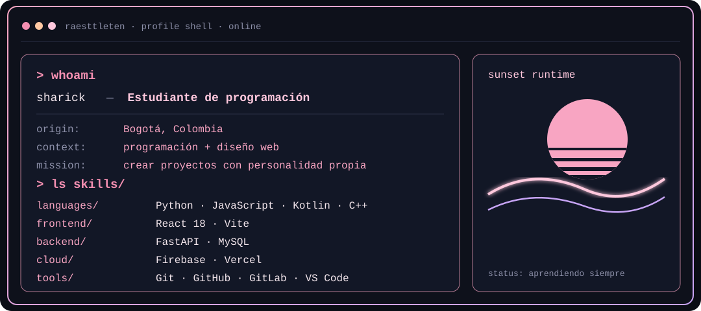

<!-- BANNER ANIMADO -->
<a href="https://github.com/raesttleten">
  <picture>
    <source media="(prefers-color-scheme: dark)" srcset="assets/banner-dark.svg">
    <source media="(prefers-color-scheme: light)" srcset="assets/banner-light.svg">
    
  </picture>
</a>

 

---

## `$ whoami`

  

 

## `$ cat tech-stack.yaml`

<table>
  <thead>
    <tr>
      <th colspan="2" align="left"><code>raesttleten:~$ cat tech-stack.yaml</code></th>
    </tr>
  </thead>
  <tbody>
    <tr>
      <td width="50%" valign="top"><code>├─ languages:</code>  
         
        <code>Python · JavaScript · Kotlin · C++</code>
      </td>
      <td width="50%" valign="top"><code>├─ frameworks:</code>  
         
        <code>FastAPI</code>
      </td>
    </tr>
    <tr>
      <td colspan="2" valign="top"><code>╰─ tools:</code>  
         
        <code>Git · GitHub · GitLab · VS Code</code>
      </td>
    </tr>
  </tbody>
  <tfoot>
    <tr>
      <td colspan="2"><code>status: learning&nbsp;&nbsp;·&nbsp;&nbsp;environment: development</code></td>
    </tr>
  </tfoot>
</table>

---

## `$ git log --stats`

  
  

<code>signals: github_stats · top_languages · status: growing</code>

---

## `$ python radar.py --signals`

  <picture>
    <source media="(prefers-color-scheme: dark)" srcset="assets/radar-dark.svg">
    <source media="(prefers-color-scheme: light)" srcset="assets/radar-light.svg">
    
  </picture>&nbsp;
  <picture>
    <source media="(prefers-color-scheme: dark)" srcset="assets/radar-langs-dark.svg">
    <source media="(prefers-color-scheme: light)" srcset="assets/radar-langs-light.svg">
    
  </picture>

<code>signals: skill_radar · language_stack_radar · status: healthy</code>

---

<!-- SOCIALS -->
## `$ connect --socials`

&nbsp;&nbsp;

 

  
  Hecho por Sharick · @raesttleten

